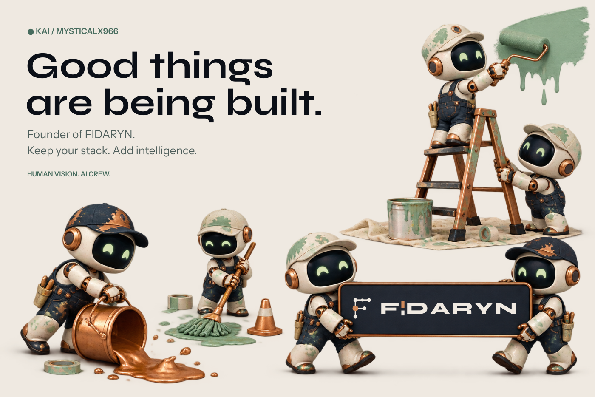
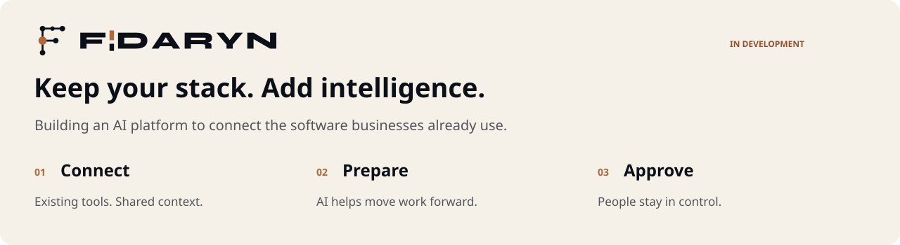

  <picture>
    <source media="(prefers-color-scheme: dark)" srcset="assets/hero-dark.png" />
    <source media="(prefers-color-scheme: light)" srcset="assets/hero-light.png" />
    
  </picture>

### KI-Mitarbeiter für den ganzen Betrieb. Digital employees for the whole business.

I'm Kai, founder of **FIDARYN**. I started building websites at 14, later worked as a technician and technical lead, and ran my own car workshop for several years. I know what happens when a system has to work on a real shop floor, not just on paper.

Today I build AI that runs real operations inside clear limits.
An online shop runs autonomously:
- **31 digital employees in seven departments**, 16 of them AI agents with their own role. 
- They handle product data, prices, stock, purchasing, marketing and customer service. 
- Supplier orders only go out with approval.

My working principles:

- **Least privilege instead of full access.** Every agent gets only the tools and permissions its job needs. These limits are enforced technically, not just written into a prompt.
- **Defined processes instead of uncontrolled autonomy.** Routine work runs on its own within rules. Anything important waits for a person.
- **Control is architecture, not a feature.** People stay in charge, and that is built into the system from the start.

 

  <picture>
    <source media="(prefers-color-scheme: dark)" srcset="assets/fidaryn-dark.svg" />
    <source media="(prefers-color-scheme: light)" srcset="assets/fidaryn-light.svg" />
    
  </picture>

### From practice, not from the ivory tower

Most companies don't have an AI problem. They have a **complexity problem**: email, accounting, tax advisor, CRM, files, calendar, ERP, online shop, industry software. Every extra system brings new logins, new interfaces and information that has to be merged somewhere.

A business owner should not have to configure an AI stack. They should be able to say: *"I need someone for this task."* That is how FIDARYN is meant to work. 
You set up a digital employee with its role, tasks, permissions, systems and area of responsibility. 
FIDARYN handles the models and tools in the background.

| Connected systems | Human oversight | Lasting knowledge |
| :--- | :--- | :--- |
| Your existing programs keep running and stay the source of your data. No migration, no data move. | AI prepares the work. People approve what matters. Every action is logged and traceable. | Working knowledge stays in the company memory, so a successor, human or AI, can pick it up with the same rights. |

FIDARYN is in development and I'm looking for pilot customers. The principles above describe the product direction. The real test is real operations, where mistakes have real consequences.

### Let's compare notes

Interested in practical AI, business software integrations or the founder journey? Get in touch.

[fidaryn.com](https://fidaryn.com) · [Find me on GitHub](https://github.com/MysticalX966) · [FIDARYN on Instagram](https://www.instagram.com/fidaryn_com/)

---

Real operations. Clear limits. Building FIDARYN.
